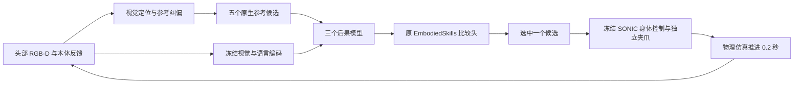

# G1 EmbodiedSkills

将 EmbodiedSkills 的观察、五候选、后果预测、选择和执行流程接入 Unitree G1。复用已有 Isaac Lab 与冻结 SONIC，先做右侧两指夹爪的桌面方块抓放。

当前阶段见 [LOG.md](LOG.md)，各阶段的实测结论放在 [docs](docs/)。规划策略作为首个候选后端；预训练 VLA 适配留待后续。

## 本地配置

仓库只保存新增源码、配置、报告与小体积指标；上游代码、模型、生成的机器人资产和实验数据通过本地路径引用。

```bash
export SONIC_ROOT=/path/to/SONIC-runtime
export EMBODIEDSKILLS_ROOT=/path/to/EmbodiedSkills
export ISAAC_PYTHON=/path/to/sonic_isaaclab/bin/isaac-python
export PYTHONPATH="$PWD/src:$SONIC_ROOT:$EMBODIEDSKILLS_ROOT/src:${PYTHONPATH:-}"
```

依赖现有 SONIC / Isaac Lab 环境，不自动更新依赖。仿真需使用其 Isaac 启动包装器，离线准备可使用同一环境的普通 Python。

## 当前可运行内容

迁移工程已完成，最新机制筛查结果如下。

**M1 封存评测完成**：100个新种子上，Full-G 75/100、无未来损失版本71/100，差值+4个百分点、95%配对区间[−8,+16]；Full-D 95/100，直接状态/动作评分器和固定候选2均为96/100，旧模型87/100。本轮未获得未来预测监督收益的明确证据。1300个计分回合及79,200次学习选择的分数重算通过，见 [M1结论](docs/09-M1预测贡献消融结论.md)。旧采集长期标签的限制见 [数据质量核查](docs/M1-测试前数据质量核查.md)。

**M2 首轮开发覆盖完成，工程验收未通过**：8个开发回合、40个锚点的九格均可行，378个分析分支有效，20个物理审计通过；但固定R3实例的两种实际腰响应均相对默认反向，未通过事前方向门。正式40回合/200锚点尚未启用。见 [M2结论](docs/10-M2身体手部交互诊断结论.md)及 [工程协议](docs/M2-工程验收与正式采集协议.md)。物理开销1980槽回合不能写成正式1980分析分支已完成。

历史迁移开发记录：五候选采集200锚点/1000分支，三个后果模型与比较头训练后，在30个开发种子上直接27/30、随机21/30、学习选择器29/30、固定候选2为25/30。这些是开发证据，不与新M1封存测试合并，也不能据其归因于预测；见 [在线闭环报告](docs/05-在线闭环与配对评测结论.md)和 [固定候选2对照](docs/06-固定候选2消融结论.md)。离线分支选择与在线反复选择分别解释。

研究路线见 [规划](docs/07-顶会研究路线与实验规划.md)，本轮原始协议见 [M1/M2计划](docs/08-M1与M2首批实验计划.md)。当前先处理身体参考的实际执行，再决定后续交互模型。


完整采集、训练及在线入口见 [复现指南](docs/复现指南.md)。阶段报告逐项区分工程检查、离线分支结果和在线任务成功率。

## 执行与学习路径



`simulation.py` 管理浮动 G1、接触、相机与重建；`candidates.py` 和 `native_reference.py` 保证候选编码与实际 SONIC 预览对应；`collection.py` 采集共同起点的五分支；`learning.py` 调用原三成员及比较头训练；`online.py` 记录每次真实预测、选择及执行。离线未来图像与成功标签只参与训练和评测。

```bash
python scripts/build_asset.py --output outputs/assets
python scripts/prepare_reference.py --output outputs/references --duration 20
python scripts/prepare_task.py --output outputs/task-pilot-v1
bash "$ISAAC_PYTHON" scripts/run_sim.py \
  --reference outputs/task-pilot-v1/native \
  --asset outputs/assets/g1_parallel_gripper.urdf \
  --output outputs/direct-demo --mode direct --seconds 24 \
  --cameras --servo --record-video
```

## 来源

- [EmbodiedSkills](https://github.com/ZJU4EmbodiedAI/EmbodiedSkills)：后果模型、比较头、训练与运行接口；当前参考版本 `e3aa582614a9601f1c826950b9673cab81da2cb0`。
- [SONIC](https://github.com/NVlabs/GR00T-WholeBodyControl)：冻结的 G1 身体跟踪控制器。
- [Isaac Lab](https://github.com/isaac-sim/IsaacLab)：物理场景与传感器。
- [CCFA-Skills](https://github.com/mikubaka88/CCFA-Skills)：阶段规划及实验记录规范。

上游代码、资产和权重遵循各自许可。本仓库不重新分发上游模型与机器人网格。
