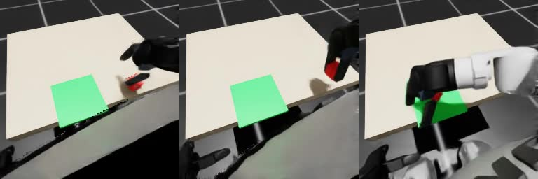

# 阶段 5：在线闭环与配对评测结论

日期：2026-10-15，北京时间。

## 结论

G1 两指夹爪、RGB-D 反馈、五候选、真实三个后果模型与比较头、冻结 SONIC 和物理抓放的完整仿真闭环已跑通。正式评测及独立审计通过，阶段 5 完成。

同一组 30 个新种子的实测结果：直接执行 27/30（90.0%），随机选择 21/30（70.0%），EmbodiedSkills 选择器 29/30（96.7%）。这些是单任务工程验收的描述性结果，不作统计优越性或新方法贡献结论。

## 冻结协议

使用阶段 4 原始训练 bundle，SHA256 `5ecd410e6ff122e827bef34d4c5ca12334fe3c9366fbcb7edcfec01658cdfa90`。开发运行之后未按测试结果重训或修改选择规则。

- 三方法分别启动全新 Isaac 进程：直接固定选候选 0；随机按种子均匀抽五候选；选择器加载真实三 WAM 与原比较头，按实际分数 argmax 选择。
- 正式种子 900000–900029，8 个物理槽位，最后一批只计 6 个有效回合；相同种子、槽位、根/关节/物块初态、资产、参考、指令与任务预算。
- 方块 XY 每轴扰动 ±2 cm；候选初始偏移 2.5 cm，仍执行统一可行性检查与缩幅。RGB-D 反馈及候选生成规则一致。
- 每次从当前 RGB 与本体状态生成 5 个 75 帧原生参考窗口；选择后推进 10 个控制步/0.2 仿真秒，重新观察。无未来图像、离线成功标签或仿真前瞻进入在线预测。
- 每回合 24 秒/1200 控制步。完整抓起、稳定放置、松爪、后撤且保持站立才成功；任务失败保留在 30 次分母中，提前终止不能成功。

全部方法保留物理轨迹、每次候选编码与选中原生指令、选择分数/哈希、实际执行步和第一批各槽录像。`scripts/summarize_evaluation.py` 独立复算成功，检查初态、编码、时钟覆盖和真实 argmax。

场景中的绿色托盘为 16 cm 方形平底面，无围边。稳定放置要求末 1 秒相对末帧的最大位移小于 4 mm、全程到目标中心距离小于 60 mm 且高度合格；不能仅用结束帧的位置判断成功。

## 开发验收

种子 990100–990102，3 槽、24 秒：成功 2/3，全部完成 120 次决策与 1200 控制步，无物理终止。360 次决策均使用真实比较头，所有分数有限、选择等于实际 argmax；候选选择分布为 `[0,9,284,43,24]`。

两次成功完成抓起、放稳与后撤。失败种子 990102 在 10.6 秒闭合时，TCP 相对方块中心偏移约 `[+1.3,-28.6,+17.9]` mm；夹爪内间距从 18.1 mm 缩到 12 秒的 4.0 mm，而成功回合同期约 35 mm。物块仅抬升 7.54 mm，录像显示擦碰推动后空夹抬起，更符合未形成稳定双侧夹持。这是观测事实与相应推断，三回合不足以归因于特定候选。

这三次只用于接口与真实执行验收，不计入正式 30 种子结果。

## 正式结果与独立审计

- 三方法各 30 回合全部完成 1200 控制步，无候选生成失败、站立失败或物理终止。每方法 3600 次选择，共 10,800 次；共执行 108,000 个有效控制步，未计最后一批填充槽位。
- 30 组根状态、31 维关节位置/速度和完整物块 13 维状态逐项比较，三方法初态最大误差均为 0。
- 全部选中原生动作、编码和哈希一致；选择器 3600 次选择均等于真实比较头分数 argmax。202 个输入/源码文件及模型在运行期间哈希未变。
- 选择器实际候选分布 `[3,89,2877,421,210]`，回合内编号变化合计 698 次。候选 2 占 79.9%，没有强制非默认切换或未来标签参与。
- 在相同种子分开运行的结果对比中，选择器在直接失败的 900002、900008、900028 上成功，但在直接成功的 900009 上失败，净多 2 次成功；相对随机多 8 次成功、无反向新增失败。这是初态配对后的观察差异，不是恢复同一中间状态的因果反事实。

机器可读结果、完整逐种子指标、输入/源码哈希和审计记录见 [metrics/stage5.json](metrics/stage5.json)。

上图为正式种子 900000 的真实头部 RGB，依次为 6、14、23 秒；中间可见方块被夹起。该回合完整 24 秒录像为本机 `outputs/stage5/formal-paired/selector/head-first-batch-slot-0.mp4`，256×256、5 fps、120 帧。第一批八个有效槽位均保存了录像，不以单段录像替代完整成功率。

## 正式基线失败分析

直接基线正式 30 回合成功 27 次，以下三个失败均完整运行到 24 秒、松爪和后撤完成且保持站立：

- 900002：未形成有效抓持，最大抬升仅 0.98 mm，物块留在桌面，最终目标距离 191.67 mm；第一批录像与物理轨迹一致。
- 900008：已抬升 98.00 mm 并放到托盘区域，最终目标距离 39.76 mm，但末秒最大位置变化 11.56 mm，未放稳。
- 900028：已抬升 101.01 mm，最终目标距离 51.58 mm；末秒最大位置变化 13.96 mm、目标距离峰值 63.95 mm，稳定性和距离条件均未通过。

后两例只依据完整轨迹分类，没有对应录像，不推断再次移动的具体接触原因。

随机基线正式成功 21/30。按首个未通过阶段互斥归类，其 9 次失败为：

- 未达到 3 cm 抬升 6 次：900001、900004、900009、900011、900018、900026，物块最终均留在桌面高度。
- 进入落放区域后最终放置不合格 2 次：900006 末秒位移 15.19 mm；900023 末秒位移 59.73 mm，距离/高度也越界。
- 放置合格但撤离不足 1 次：900005 的 TCP 与物块最终相距 56.74 mm，低于 60 mm 阈值。

900023 同时存在撤离不足，不重复计入失败总数。随机基线没有释放失败、站立失败或物理终止。

选择器唯一失败为 900009：最大抬升 9.88 mm，最终目标距离 189.05 mm，物块仍在桌面高度；10.4 秒夹爪已空闭到约 4.09 mm。释放、撤离和站立均通过，按未抓起归类，不推断具体接触原因。

## 耗时与资源

三方法独立进程耗时分别为 400.45、401.96、424.53 秒（含启动与退出），完整评测及约 10 秒独立审计共 1237.93 秒，约 20.6 分钟。

每约 10 秒采样的整卡显存最大值：直接/随机 7274 MiB，选择器 8093 MiB，包含桌面、SONIC 与 RTX 渲染。选择器的 PyTorch allocator 峰值约 1.37 GiB，口径不包含渲染，不能拿它代替整卡需求。本机硬件及环境版本见 [metrics/runtime.json](metrics/runtime.json)。

当前最多 8 个有效环境组成一次决策批次，末批为 6 个。选择器的实际批次延迟：

- 完整决策平均 333.55 ms，P95 510.28 ms，含候选、渲染、推理、原生补丁和记录开销。
- 冻结编码器平均 36.86 ms，P95 38.50 ms。
- 三后果模型与比较头平均 4.75 ms，P95 4.90 ms。

直接/随机同样生成五候选并保存审计资料，完整决策平均分别为 288.25/291.38 ms；这里不是删除候选与记录开销后的最简直接控制速度。

## 复现与范围

完整入口见 [复现指南](复现指南.md) 的 `scripts/evaluate_online.py`。原始输出目录为 `outputs/stage5/formal-paired/`，大型轨迹、决策档案、模型与视频按计划保留本机。

本轮为固定视觉规划后端、单任务、右侧两指夹爪、仿真操作。基座浮动、SONIC 冻结，物块依靠真实接触抓持。尚无移动操作、VLA 泛化、真机或统计性能提升结论。

离线测试仍是选择器 28/30、直接 29/30，与在线结果不能混为一谈；训练的单次干预后续与在线反复选择存在分布差异。比较头强烈偏向候选 2，且尚未做固定偏移候选对照；当前结果无法区分学到的选择收益和偏移先验收益。未来创新研究应另设实验，本轮到迁移基线为止。

推理时间按实际批次记录，实验使用 8 个并行环境；仿真时间与实际墙钟时间分别报告。批量实验延迟不能当作单台真机的传感到执行端到端延迟，本阶段不作真机实时性结论。
