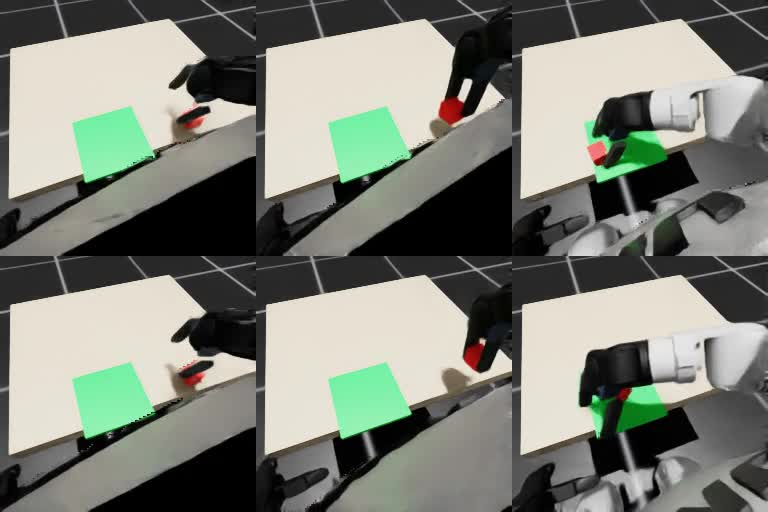

# 固定候选 2 对照实验

日期：2026-10-15，北京时间。

## 结论

补充对照完成，物理结果与配对审计通过。同一组 30 个种子：

- 直接执行：27/30，90.0%（复核原记录）。
- 始终选择候选 2：25/30，83.3%（本次新增执行）。
- EmbodiedSkills：29/30，96.7%（复核原记录）。

学习选择器相对固定候选 2 多成功 4 次，即 13.3 个百分点；配对结果为救回 5 个种子、另新增 1 个失败。当前结果支持自适应选择相对这条固定策略具有初步收益，原 29/30 不能由“始终选 2”这个对照完整复现。后果预测本身的贡献仍需另做组件消融。

## 问题与协议

原在线实验中，EmbodiedSkills 为 29/30，直接执行为 27/30，且学习选择器有 79.9% 的决策选择候选 2。本次补充“始终选择候选 2”的对照，检验相对直接执行的收益是否能由固定方向偏好解释。

候选 2 对应手部目标沿世界 −X 方向修正，初始偏移 2.5 cm，并沿用原可行性检查和必要的幅度缩小。对照每 0.2 仿真秒仍根据当前 RGB-D、本体状态和参考纠偏重新生成五个候选，始终执行当前编号 2；不加载视觉编码器、三个后果模型或比较头。它保留反馈控制，不是预录动作轨迹。

沿用原种子 900000–900029、8 个环境槽位、24 秒/1200 控制步、方块 XY 每轴 ±2 cm、相同资产/参考/SONIC 权重和全部成功判据。第一批全部有效槽位录像，失败保留在 30 回合分母中。

这是在已知原结果后补做的对照，不是新的未知测试集。直接执行和 EmbodiedSkills 复用阶段 5 的实际记录，独立重新审计；本次只新增固定候选 2 的 30 次物理执行，不重新训练或修改已有结果。

## 配对结果与审计

- 固定策略的 30 回合全部完成 24 秒；3600 次选择均为 2，执行 36,000 个控制步，编码器和选择器推理次数均为 0。没有候选生成失败或物理终止。
- 三方法同种子、槽位、根状态、关节位置/速度和完整物块 13 维初态最大误差均为 0；物理成功、原生编码、实际控制覆盖与学习选择器 argmax 复核通过。
- 原始基线全部 11,020 个文件的前后哈希完全一致。运行期间源码和模型未变；运行前只允许固定模式接入及审计的三处旧代码变化，其余原输入逐项匹配。
- 学习选择器相对固定策略救回 900000、900004、900005、900018、900019；固定策略成功而学习选择器失败的是 900009（未抓起）。两者共同成功 24 次，没有共同失败。
- 固定策略相对直接执行救回原三个失败种子，但新增 5 个失败，净少成功 2 次。因此固定 −X 修正并非普遍有利。

## 失败解释与时序观察

固定策略 30 次都达到 3 cm 抬升，并完成松爪、后撤与站立；5 次失败均发生在预设最终放置判据。末秒高度全部合格：

- 900000、900004：稳定，但最大目标距离分别为 65.919、62.341 mm，超过预设 60 mm。
- 900005、900018、900019：距离合格，但末秒相对末帧的最大位移分别为 5.434、18.468、9.311 mm，超过预设 4 mm。

这些是落点精度或稳定性不合格，不能描述成全部未放到托盘。判据与之前三方法完全一致，没有按本次结果调整。

上排为固定候选 2，下排为 EmbodiedSkills，均为种子 900000 的 6、14、23 秒真实 RGB。两者均抓起并放到绿色托盘区域；固定策略因最终距中心 65.919 mm 超过原距离门限而失败。完整录像保留在各自原始输出目录。

需要区分最终结果与即时选择机制：上述 5 个救回种子中，学习选择器在 0–17 秒共作出 131 次非 2 选择，但在 17–24 秒的 175 次决策全部仍选 2。不能把收益归因为“释放或后撤时换候选救回”；较早的选择与后续状态演化可能有关，具体阶段和后果模型的作用未单独隔离。

## 指标解释与资源

按全部 30 回合（包含失败）统计，最终到目标中心的平均距离：直接 21.36 mm、固定候选 2 为 23.80 mm、学习选择器 22.85 mm；中位数分别为 14.75、21.56、16.49 mm。学习选择器的综合任务成功率更高，并非所有连续指标均优于直接执行。

学习选择器与固定策略的 6 个结果不一致种子为 5 胜 1 负；探索性精确配对检验双侧 `p=0.21875`。本次是在已知候选偏好后补做的同种子诊断，30 个种子尚不足以确认稳定的统计优势或外推至其他任务。

新增执行与审计总用时 442.83 秒，约 7.4 分钟；其中 fixed2 完整仿真进程 429.46 秒。整卡显存每约 10 秒采样峰值 7605 MiB，包含桌面及 RTX 渲染。批次决策有一次约 12.53 秒的墙钟长尾，来源未单独定位；本轮不据不同进程的耗时推断速度优势，物理预算和实际步数均完整通过复核。

机器可读结果、逐种子判据、时序选择与源文件指纹见 [metrics/stage6.json](metrics/stage6.json)。

## 复现与证据

协议配置：`configs/evaluation-fixed2.json`。执行入口：`scripts/evaluate_fixed2.py`。原始实验：`outputs/stage5/formal-paired/`；新对照及比较报告保存在 `outputs/stage6/fixed2-control/`。

只扩展模式接入、固定编号分派及对应审计。候选生成、视觉反馈、物理环境、动作编码、成功判据和原学习模型均保持原版本；运行前逐项对照原实验输入哈希，运行期间继续冻结源码与权重。
