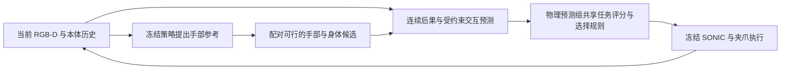

# 从迁移基线到人形研究：判断与下一步

日期：2026-10-15，北京时间。本文是研究分析与拟议实验方案；没有新增实验结果，也没有确定投稿会议。

## 1. 当前已经验证到哪一步

可以确认两点：G1、夹爪、Isaac Lab、冻结 SONIC 和 EmbodiedSkills 的完整闭环已经跑通；学习选择相对一个固定方向策略出现了初步收益。

同组 30 个种子的实测结果为：直接执行 27/30，固定候选 2 为 25/30，EmbodiedSkills 为 29/30。学习选择器相对固定候选 2 救回 5 次、另失败 1 次，净多 4 次成功；相对直接执行净多 2 次。对应探索性双侧精确配对检验分别为 p=0.21875、p=0.625。这组数据支持继续研究，尚不足以确认稳定的统计优势。

固定候选 2 仍有每 0.2 仿真秒的感知和反馈，并非开环轨迹。这个对照排除了“始终沿 −X 修正就能完整复现当前收益”的解释，但没有排除阶段调度、状态反馈分类器等更强解释。未来预测的独立贡献尚未隔离。实测细节见 [固定候选 2 报告](06-固定候选2消融结论.md)。

当前证据还有四个直接影响选题的边界：

- 上层是几何视觉规划器，尚未接入真正的预训练 VLA；语言只有一条固定指令。
- 主要改变右臂参考，没有要求行走或显著全身协调；各方法都保持站立，不能据此声称改善平衡或全身操作。
- 训练只有 40 个独立回合、200 个锚点。1000 条分支中默认候选成功 194/200，可救回默认失败的锚点只有 3 个，辨别候选优劣的监督很少。
- 离线测试选择器 28/30，直接 29/30。短期视觉特征预测相对“不变化”的增益很小，不能把在线成功率的变化直接归因于更准确的物理预测。

因此，当前成果适合作为可复现的迁移基线和研究平台。单纯增加任务数量、改网络名称或把人形状态加入输入，方法新意仍然不足。

## 2. 近期工作已经覆盖了什么

以下是截至本文日期的定向检索，依据原始论文，属于局部新颖性检查，尚非系统性综述；预印本不等于已被会议接收。

- [EmbodiedSkills v2，§3.4、§5.5](https://arxiv.org/html/2609.01281v2) 已有共同起点候选分支、短期后果监督、较长策略续行结果、无预测监督消融，以及集成分歧和相对收益选择。因此，“反事实分支”“多步结果”“不确定性回退”本身均不能直接算本项目的新意。
- [HWAM，§3](https://arxiv.org/html/2610.12026) 显式建模高层参考与实际执行身体状态之间的差距，将执行后本体状态与动作共同生成。增加身体预测头不能据此主张首次解决执行差距。
- [WholeBodyWAM，§III](https://arxiv.org/html/2609.16644) 已研究全身控制接口、控制器语义和操作可操作性引导的全身协调。把 WAM 接入 SONIC 或增加全身命令流仍需更具体的差异。
- [Robot-Factored World Models，§3](https://arxiv.org/html/2607.22535) 把控制器实现出的名义机器人运动与接触后的场景响应分开。因此，运动学加学习残差或身体与场景分解也已有紧邻工作。
- [ViSkill，§III-C](https://arxiv.org/html/2307.16503)、[Foresight Residual RL，§IV–V](https://arxiv.org/html/2607.16506) 已用后续技能的完成概率优化技能衔接；[RESCUE，§III](https://arxiv.org/html/2610.13516) 明确考虑状态、干预、续行策略和预算共同决定的可恢复性。把成功预测改称“可恢复性”不会自动产生新方法。
- [CA³C，§3](https://arxiv.org/html/2610.07949) 已用预测后果决定候选与执行长度。“根据预测调整动作块长度”也需要进一步区分。

这些工作说明，人形 WAM 方向已有直接竞争。建议围绕一个可测量的学习瓶颈建立贡献，避免以平台迁移或模块堆叠作为论文主线。

## 3. 建议优先验证的研究主线

### 3.1 核心问题

**冻结全身控制器时，同样的手部修正在不同身体参考下，可能产生不同甚至相反的接触效果。能否用少量受控分支，学到这种耦合，并正确排序未见过的手部—身体组合？**

例如，同一世界坐标中的抓取目标，可能通过站直伸臂或降低身体完成。二者名义末端目标接近，但实际跟踪误差、接触时速度和夹持后的物体响应可能不同。这里值得研究的是如何有效学习这种差异，而不是声称首次发现身体与手部存在耦合。

当前工程正好提供共同起点物理分支、冻结控制器和原生动作审计，适合用来辨别这一问题。当前实验尚未证明该现象显著存在，必须先做小规模诊断。

### 3.2 一个具体的方法假说

将候选明确分成手部参考 u 和身体参考 b。比较不同 b 时，统一同一 u 在世界坐标中的末端位姿轨迹及执行时序，并记录名义运动学实现与实际执行的差异。b 先限定为 SONIC 能稳定跟踪的少量躯干或身体高度参考，暂不同时加入行走、双手和灵巧操作。

在同一锚点，以 u₀、b₀ 为默认参考，交叉执行：

```text
                 身体 b₀       身体 b₁
手部 u₀          Y(u₀,b₀)     Y(u₀,b₁)
手部 u₁          Y(u₁,b₀)     Y(u₁,b₁)
```

Y 优先取连续物理结果：实际末端相对目标的误差、物体位姿变化、物体与夹爪相对滑移，以及身体姿态变化。定义交互差分：

```text
Γ(u,b) = Y(u,b) − Y(u,b₀) − Y(u₀,b) + Y(u₀,b₀)
```

它用于区分手部变化、身体变化和二者共同作用。二值成功率不能作为唯一的 Γ 目标，因为成功门限本身就能制造非加性；原始图像潜变量还会混入头部相机运动。

候选模型预测“默认后果 + 手部增量 + 身体增量 + 受约束的交互残差”。交互残差在任一参考回到默认时为零，并限制为少量可复用耦合模式。例如：

```text
g(s,u,b) = Σᵣ wᵣ(s) · [φᵣ(s,u)−φᵣ(s,u₀)] · [ψᵣ(s,b)−ψᵣ(s,b₀)]
```

wᵣ 可输出各连续结果维度的权重；模式数由验证集确定。先测试锚点约束和低秩结构，只有失败分析支持时才增加接触条件化等结构。冻结的视觉编码、本体反馈与历史提供 s；未来物理真值仅作离线监督，不作部署输入。

这一公式和交互分解本身都是通用建模工具。潜在贡献必须落在：**适用于冻结全身执行器的受控干预采集与约束交互学习，在相同数据预算下改善未见参考组合的物理预测和候选排序。**任意拼接 MLP 也可以学习交互，因此必须与等容量模型正面对比。当前只建议将其作为优先研究假说，尚不能宣称方法新颖已确认。

### 3.3 与最近工作的预期差别

相对 EmbodiedSkills，研究对象由固定身体参考下的手部扰动，变为身体与手部参考的组合泛化；方法差异由受控因子干预和受约束交互监督承担。

相对 HWAM、WholeBodyWAM，重点是冻结既有策略和控制器后，如何高效评价其组合候选，而非联合训练新的全身生成策略。相对 Robot-Factored WM，重点是辨别并复用实际执行中的身体—手部交互，而非渲染名义机器人轨迹作为视频条件。这些是目前检索支持的定位差别，不足以替代后续对交互学习、组合动力学模型的专门检索。

## 4. 按证据推进的阶段计划

### M1：先分清现有收益来自哪里

目标是隔离未来预测、状态反馈和时间阶段偏好的作用。

- 保留当前 30 种子结果作为开发证据。另封存新的测试种子与任务实例，在打开结果前冻结划分、指标、训练预算和选模规则。
- 保留直接执行、固定候选 2、原完整 EmbodiedSkills。再从验证集选择五候选中最好的固定候选，避免只挑战一个事后挑选的固定策略。
- 增加只看任务阶段或时间的选择器，检验当前固定时间流程能否解释主要收益。
- 从头训练无未来预测监督版本，沿用相同数据、结果标签、容量和训练预算；另以状态/动作到结果的直接 critic 作为强替代。两者可共享实验设计，但须明确各自移除的是监督还是表示结构。
- 置零或打乱已训练模型的预测特征可以辅助定位依赖关系，不能替代重新训练的公平基线。

先做一套训练 bundle 的机制筛查，再对保留的关键比较运行至少三套独立完整训练。三个集成成员属于同一个方法实例，不能算三个完整训练重复。

预算起点可设为每个任务 100–200 个新测试种子；最终规模依据独立开发数据中的配对分歧和目标精度决定，该数量不保证统计显著。报告成功率、配对救回/伤害、置信区间和全部回合的连续放置误差。

决策：若无预测版本稳定持平或更好，应收回“现有收益来自未来预测”的解释；先分析数据与任务是否需要预测，再决定是否保留 WAM 为核心。

### M2：建立真正需要身体协调的最小问题

先做两个紧密相关场景：不同高度抓放，以及远侧/侧向抓放。起步仅使用三种可行手部参考 × 三种可行身体参考；身体候选必须产生实际可测的身体运动，且至少存在有效成功候选。

采用约 200 个共同起点锚点的小规模交叉试验，完整 3×3 网格最多 1800 条分支。这是预算建议，不是已采集数据。先确认：

1. 身体参考确实改变实际末端跟踪和物体响应，而不只是改变名义坐标。
2. 存在跨身体条件的候选排序变化；Γ 超过同配置重复物理执行的噪声水平。
3. 简单几何评分、阶段策略和原 EmbodiedSkills 存在可定位的失误，同时候选集合包含可行解。

手部位姿轨迹及执行时序、比较窗口、动作幅度与实际交付编码都要核验，并用名义运动学基线量化已知几何能解释的差异。若可行性检查在某个网格单元偷偷缩小手部幅度，该单元不能直接作为干净的因子对比；要记录拒绝或使用共同可行幅度，不能把无效项替换成有利样本。反事实分支继续复用同步锚点、完整历史重放和物理重建审计。

决策：若身体变化没有产生实质差异，或全部差异都由已知运动学解释，不扩大该选题。若根本没有好的候选，先完善候选生成，不能归责选择器。

### M3：验证交互学习，而不是增加网络规模

在 M2 现象成立后，再扩展采集并比较：

- 原完整 EmbodiedSkills；相同新候选集、观测和采集预算。
- 等容量全拼接后果预测器；检验通用网络是否已足够。
- 只有手部和身体独立增量、没有交互项的预测器。
- 有受约束交互项、但没有配对差分监督的版本。
- 有相同监督、但没有锚点约束或低秩限制的版本。
- 纯几何/名义运动学评分，以及 M1 保留的无预测 critic。

检验交互结构的各预测版本统一连续目标 Y、评分器输入、训练预算和选模规则，拼接基线同样获得全部物理监督。原完整 EmbodiedSkills 保留原视觉后果和比较头，作为端到端参照单独报告。新增物理表示的收益与交互结构的收益分开衡量，不能直接将原视觉比较头接到不兼容的物理特征。

最关键的测试是：训练中手部参考和身体参考各自出现过，但某些组合完整留出。划分以完整场景/回合和组合条件为单位；同一回合的帧、锚点或分支不能散入训练和测试。各方法获得相同的已观察网格单元；为测试构造 Γ 所需的留出单元不能进入训练差分标签。在同一批未见场景上分别统计已见组合与留出组合，区分场景泛化和组合泛化。

同时画数据量—排序误差和数据量—闭环成功曲线，检验“更少数据学会未见组合”的主张。不要把已见组合上的拟合提升误写成组合泛化。

候选排序指标包括实际回报遗憾、结果不同候选之间的排序准确率；候选可挽救比例作为独立上界诊断。该上界属于明确续行策略和预算下的分支上界，不是最优策略上界。任务指标仍由完整闭环决定。

若在线反复选择明显偏离采集分布，补充冻结轮次的混合策略采集；每轮明确标签所用的续行策略和剩余时间。对全部方法使用同样的数据，避免把数据覆盖收益算成模型结构收益。

决策：若等容量拼接模型达到同样的数据效率和组合泛化，交互分解就不应作为论文核心贡献。

### M4：形成完整论文证据

在前述机制成立后，建议形成三个任务族：多高度抓放、远侧/侧向转移、抓取—转移—放置—撤手的组合任务。第三类用于检验较早身体动作对后续接触和放置的影响。移动操作只在站立协调结果稳定后作为扩展，不列为第一轮必做项。

泛化分别测试：未见参考组合、未见高度/位置、未见负载或摩擦，以及可控的延迟或跟踪增益变化。分别报告条件，不把一项同时改变多种因素的结果用于解释单一机制。SONIC 参数变化属于执行条件变化；只有换用独立控制器并完成接口验证后，才使用“跨控制器”表述。

接入第二个真实学习策略后端，例如能输出相同参考接口的扩散策略或 VLA，使几何后端成为可解释对照。若仅验证几何规划器，论文应限定为冻结控制栈的增强；不能声称已增强通用 VLA。

根据可用代码、权重及接口，选取能在同一 G1 任务上公平运行的最近全身模型作为比较；不能把不同机器人、数据和任务上的作者数字并列当本地实测。另加入冻结 SONIC 的无场景名义预演加几何评分，检验学习模块是否超过部署时可计算的执行先验；它属于受 Robot-Factored WM 启发的机制基线，不能标成整篇方法的复现。预演的计算开销同样计入延迟。

真机 G1 建议覆盖两个最能体现身体协调的任务、多个高度/位置条件，对直接执行、原 EmbodiedSkills、最强无预测基线和新方法作交错顺序比较。预算起点为每方法每任务约 20–30 次，具体依据方差与成本调整，保留全部失败，不以演示视频替代统计。

部署前单独测量单机器人感知到新命令的墙钟延迟、过期命令和运动质量。当前批次平均决策耗时 333.55 ms 不能支持 5 Hz 实时闭环；低层 50 Hz 控制和仿真中每 0.2 秒选择也不等于上层实时时钟部署。

## 5. 工程结构与算力安排

保留原迁移基线，新增研究功能通过独立配置启用。建议复用：

- `simulation.py`：场景、相机和真实接触。
- `native_reference.py`、`candidates.py`：身体/手部候选接口及实际编码审计。
- `collection.py`：共同起点分支，扩展为因子网格和续行策略记录。
- `learning.py`、`online.py`：原模型基线和在线选择入口。

拟新增的功能模块是连续物理后果目标、身体—手部因子候选、受约束交互预测及组合划分评测；它们尚未实现。训练与在线共用同一坐标规范和动作编码，避免一套名义候选用于预测、另一套实际参考用于控制。



第一轮建议沿用既有冻结编码器和 SONIC，仅训练轻量后果模块，单卡 4090 顺序推进。当前场景整卡采样显存峰值约 7.9 GiB，这只说明现有配置可运行，不能保证新场景、新渲染批量或 VLA 同驻留的显存需求。

资源重点放在有辨别力的真实物理分支。先做 M1 和 M2 小试，再确定扩大到 1000–2000 锚点是否值得；3×3 网格对应 9000–18000 分支。既有 1000 分支采集约 78 分钟只能作为量级参考，新场景时长、并行度、渲染与恢复成本都可能改变。暂不训练新的大规模视频生成模型或全身基础策略。

每个完成的实验阶段继续保存中文结论到 `docs/`、精简更新 `LOG.md`，以 `sxh-kk` 身份和中文 commit 推送。原实验数据和权重保留，报告区分旧基线、新测结果与尚未验证的假说。

## 6. 论文叙事与当前判断

若上述证据成立，可形成如下论证：

1. 冻结全身执行器下，身体与手部参考的组合会改变接触结果和候选排序；单纯扩大动作接口不足以高效学习这种差异。
2. 共同起点的受控因子分支提供直接的交互监督；锚点约束和有限交互模式将监督转化为可复用的学习结构。
3. 新结构在相同数据预算下改善未见组合的预测、选择和完整任务成功，并在真机保持收益。

预期贡献应是可操作的学习方法、能区分替代解释的机制证据，以及仿真到真机的验证。平台迁移、更多任务和更大网络承担支撑作用。

就选题匹配而言，有清楚物理机制与 G1 真机证据时，可优先按 CoRL/RSS 等机器人学习与机器人研究场景打磨；若进一步展示跨策略、跨控制器的通用学习规律，再考虑更广的机器学习会议。这是研究定位判断，不涉及录用概率或会议等级承诺。

当前判断：工程基线已经足够支撑研究起步；未来预测贡献仍待隔离；受控身体—手部交互学习比单纯迁移更有明确的问题和反驳条件，但新颖性与效果均未确认。最值得启动的下一批工作是 M1 强消融和 M2 小规模因子诊断，待结果决定是否投入 M3。
